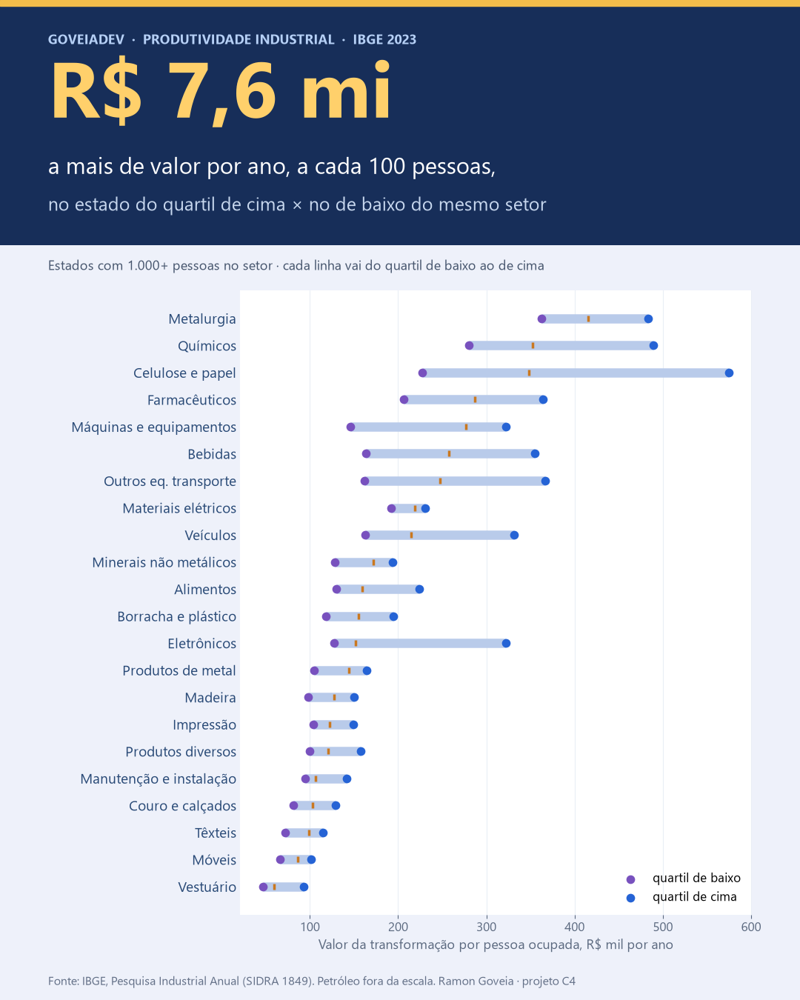

# No mesmo setor, R$ 7,6 milhões por ano de distância a cada 100 pessoas

**Na indústria de transformação brasileira, em 2023, 100 pessoas num estado do quartil de
cima do próprio setor geraram R$ 7,6 milhões a mais de valor da transformação por ano
do que 100 pessoas num estado do quartil de baixo. É a mediana entre 23 setores; o
quartil de cima gera 1,65 vez o de baixo.**

**[→ Abrir o painel Produtividade Industrial](https://goveiadev.github.io/c4-produtividade-industrial/painel/)**.
Escolha setor, estado e ano, veja onde cada estado fica no mapa de calor e compare a sua
operação na calculadora.



## A pergunta

**A produtividade da minha operação está no padrão do setor?** Quem dirige uma fábrica
sabe quanto fatura e quantas pessoas tem, mas raramente sabe com quem se comparar.
Benchmark pago custa caro. O IBGE publica todo ano, de graça, o valor que cada setor da
indústria gera por pessoa em cada estado. Este projeto transforma isso em régua.

## Os dados

- **[Pesquisa Industrial Anual – Empresa (PIA), IBGE, tabela SIDRA 1849](https://sidra.ibge.gov.br/tabela/1849)**.
  Unidades locais industriais de empresas com 5 ou mais pessoas ocupadas, por estado e
  pelas 24 divisões da indústria de transformação (CNAE 2.0), de 2007 a 2023. Baixada
  pela API do SIDRA (`baixar_dados.py`), 102.816 valores.
- Cada registro é um setor num estado num ano: pessoal ocupado em 31/12, valor da
  transformação industrial (VTI), receita líquida, salários e encargos, em reais
  correntes.
- 12% das células vêm omitidas pelo IBGE por sigilo (poucas empresas). Ficam vazias,
  sem estimativa.

## O que eu fiz

1. **Valor por pessoa** = VTI ÷ pessoal ocupado. O VTI é o que a fábrica produz menos o
   que consome de insumo, ou seja, o valor que ela acrescenta.
2. **Regra de comparação:** dentro de cada setor e ano, só entram estados com 1.000
   pessoas ou mais, e só setores com 6 estados nessa condição. Assim uma única fábrica
   não define um estado.
3. **Quartis entre estados**, sem ponderar pelo tamanho. A distância entre o quartil de
   cima e o de baixo, vezes 100 pessoas, é o número do projeto. O resultado final é a
   mediana dessa distância entre os setores.
4. **Peso da folha** = (salários + encargos) ÷ VTI.
5. Entre anos, comparo só razões (quartil ÷ quartil, estado ÷ mediana, folha ÷ VTI),
   que não dependem da inflação.

| 2023 | Quartil de baixo | Mediana | Quartil de cima | Distância por 100 pessoas |
|---|---|---|---|---|
| Alimentos (26 estados) | R$ 130 mil | R$ 159 mil | R$ 224 mil | R$ 9,4 mi/ano |
| Metalurgia (16) | R$ 362 mil | R$ 416 mil | R$ 484 mil | R$ 12,1 mi/ano |
| Veículos (13) | R$ 163 mil | R$ 215 mil | R$ 332 mil | R$ 16,9 mi/ano |
| Celulose e papel (14) | R$ 227 mil | R$ 348 mil | R$ 575 mil | R$ 34,7 mi/ano |
| Móveis (20) | R$ 66 mil | R$ 86 mil | R$ 101 mil | R$ 3,5 mi/ano |
| **Mediana dos 23 setores** | | | | **R$ 7,6 mi/ano** |

Valores por pessoa ocupada, por ano.

**Peso da folha:** em 2023, R$ 32 de salários e encargos a cada R$ 100 de VTI na
indústria de transformação. Em 2016 eram R$ 41; em 2022, R$ 28.

**A distância diminuiu pouco:** a razão mediana entre o quartil de cima e o de baixo foi
de 1,90 em 2007 para 1,65 em 2023.

## O que isso significa

**Para o diretor de uma fábrica, a pergunta deixa de ser "estamos bem?" e vira "a que
distância estamos, em reais?".** Se a operação gera R$ 130 mil de VTI por pessoa em
alimentos, está no quartil de baixo do setor. Com a mesma equipe de 200 pessoas, chegar à
mediana dos estados seria R$ 5,9 milhões a mais de valor por ano. A calculadora do painel
faz essa conta com os números de cada um.

**A distância é um mapa de onde perguntar.** Escala, automação, mix de produto, preço
de venda e terceirização explicam a diferença em proporções que este dado não separa.
Antes de investir, é preciso saber qual desses motivos se aplica.

**A folha pesa menos do que parece.** Na indústria toda, salários e encargos levam cerca
de um terço do valor gerado. Cortar pessoal mexe nessa parte; os outros dois terços
dependem de quanto valor cada pessoa consegue produzir.

## Limitações

- **VTI não é lucro** nem o valor adicionado das contas nacionais: não desconta
  depreciação, despesas comerciais, administrativas e financeiras.
- **Pessoal ocupado em 31/12**, não horas trabalhadas. Terceirizado não entra: o setor ou
  estado que terceiriza muito parece mais produtivo.
- **A divisão da CNAE é ampla.** "Alimentos" junta frigorífico, laticínio e açúcar. Parte
  da distância entre estados é mistura de produto, não eficiência. A tabela por grupo de
  atividade só existe para Sul e Sudeste.
- **Unidade local, não empresa.** O preço de transferência entre filiais de estados
  diferentes pode deslocar valor de um estado para outro.
- **Sigilo:** os estados com poucas fábricas no setor ficam fora da comparação, então os
  quartis descrevem os estados com indústria relevante naquele setor.
- **Quartis sem peso:** um estado com 1.000 pessoas conta igual a um com 200 mil. É a
  comparação certa para "qual estado se parece comigo", não para a média nacional.
- **Petróleo e biocombustíveis** tem distância de R$ 166 mi por 100 pessoas, puxada por
  refinarias. Entra no cálculo da mediana, mas fica fora da escala na capa. Fumo fica de
  fora: só 5 estados têm 1.000 pessoas.
- **A calculadora compara, não promete.** Um número abaixo da mediana diz onde investigar,
  não quanto se ganha mudando.

## Como rodar

```bash
python -m venv .venv
.venv/Scripts/pip install -r ../requirements.txt
.venv/Scripts/python baixar_dados.py dados/pia_1849.csv
.venv/Scripts/jupyter nbconvert --to notebook --execute --inplace analise.ipynb
```

O notebook exporta `painel/dados.js`. O painel é HTML estático: abra
`painel/index.html` num servidor local (`python -m http.server`) e tudo é recalculado no
navegador.

---
Ramon Goveia · [linkedin.com/in/ramon-goveia-92266443](https://www.linkedin.com/in/ramon-goveia-92266443) · projeto C4 de 16 do portfólio
